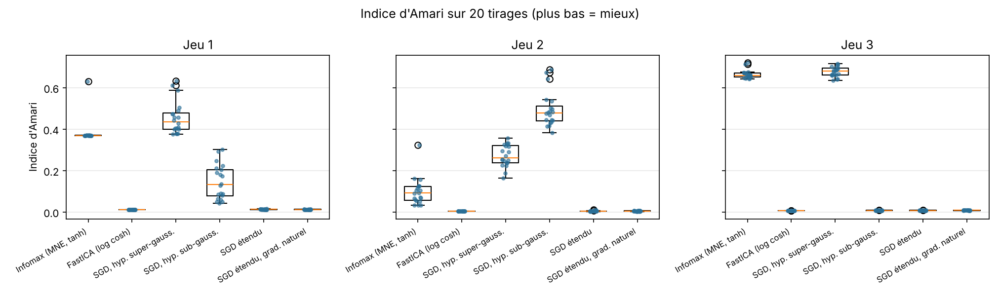

# ICA et optimisation stochastique : comparaison d'algorithmes et application à l'IRM fonctionnelle

Projet de Master 2 Data Science (Université Paris-Saclay, cours de Réduction de dimension, 2026).

**En bref :** j'ai implémenté une ICA par gradient stochastique (`SGDICA`) avec trois variantes : hypothèse fixe sur les sources, Infomax étendu, et gradient naturel. Je l'ai comparée à Infomax et FastICA sur des signaux simulés (indice d'Amari, 20 tirages). Les mêmes outils sont ensuite appliqués à des données réelles d'IRM fonctionnelle (ADHD-200), avec une ICA probabiliste (PICA).

 📓 [Simulations](notebooks/01_simulations.ipynb) · 🧠 [IRMf](notebooks/02_irmf_pica.ipynb)



## Question étudiée

On observe un mélange linéaire `x = A s` de signaux indépendants. Peut-on retrouver les sources `s` sans connaître `A` ? L'ICA y répond en cherchant les directions les plus **non gaussiennes**. Le projet étudie l'effet de deux choix :

1. l'**hypothèse faite sur la densité des sources** : sources super-gaussiennes (à pic, à queues lourdes) ou sub-gaussiennes (plates, bimodales) ;
2. l'**algorithme d'optimisation** : point fixe (FastICA), gradient batch (Infomax), gradient stochastique ordinaire ou naturel.

## Résultats

Indice d'Amari moyen sur 20 matrices de mélange aléatoires (0 = séparation parfaite). Toutes les méthodes voient **exactement les mêmes sources et les mêmes mélanges**.

| Méthode | Jeu 1 (mixte) | Jeu 2 (super-gaussien) | Jeu 3 (sub-gaussien) |
|---|---|---|---|
| Infomax (MNE, `tanh`) | 0,383 | 0,099 | 0,665 |
| FastICA (`log cosh`) | **0,012** | **0,005** | **0,008** |
| SGD, hypothèse super-gaussienne | 0,454 | 0,272 | 0,677 |
| SGD, hypothèse sub-gaussienne | 0,145 | 0,494 | **0,008** |
| **SGD étendu** | **0,013** | **0,005** | **0,008** |
| **SGD étendu, gradient naturel** | **0,012** | **0,005** | **0,008** |

Le détail (écarts-types) est dans [`results/amari_summary.csv`](results/amari_summary.csv).

**À retenir**
- **Une hypothèse fausse sur les sources fait échouer la séparation**, quel que soit l'optimiseur. Infomax avec `tanh` et SGD sous hypothèse super-gaussienne échouent tous les deux sur le jeu 3 (Amari ≈ 0,67).
- **La version étendue** (Lee et al., 1999) estime à chaque époque si chaque source est sub- ou super-gaussienne. Elle atteint le niveau de FastICA sur les trois jeux.
- **Le gradient naturel** (Amari, 1998), restreint aux rotations et appliqué par une transformation de Cayley, évite d'inverser `W` à chaque pas et reste stable pour tous les pas testés.

## Méthode

- **Données** : trois sources de 2 000 points, normalisées. Jeu 1 : sinusoïde, signal carré, Laplace. Jeu 2 : sinusoïde, exponentielle, Laplace. Jeu 3 : sinusoïde, signal carré, uniforme.
- **SGD-ICA** ([`src/ica_stoch/sgd_ica.py`](src/ica_stoch/sgd_ica.py)) : blanchiment, montée de gradient stochastique sur la log-vraisemblance, pas de Robbins-Monro `η₀/(1+époque)`, reprojection orthogonale. Le pas `η₀` est choisi par recherche sur grille.
- **PICA sur IRMf** ([`src/ica_stoch/fmri.py`](src/ica_stoch/fmri.py)) : PCA préliminaire, PPCA, blanchiment corrigé du bruit, ICA, puis retour aux cartes cérébrales. Le nombre de composantes `q` est choisi par critère BIC (Minka, 2000), et les composantes sont classées par kurtosis de leur carte spatiale.

## Reproduire

```bash
git clone https://github.com/elikosarah/ICA-Stochastique-2026.git
cd ICA-Stochastique-2026
python -m venv .venv && source .venv/bin/activate
pip install -r requirements.txt

pytest                              # 21 tests, ~5 s
python scripts/run_benchmark.py     # tableau et figures ci-dessus, ~4 min
jupyter notebook notebooks/
```

Les données ADHD-200 (~100 Mo) sont téléchargées par `nilearn` à la première exécution du notebook 2.

## Structure

```
├── src/ica_stoch/
│   ├── data.py          # scénarios de sources et matrices de mélange
│   ├── metrics.py       # indice d'Amari
│   ├── sgd_ica.py       # SGD-ICA (super / sub / étendu, gradient ordinaire / naturel)
│   ├── experiments.py   # protocole commun : Infomax, FastICA, SGD-ICA ; recherche du pas
│   ├── fmri.py          # PICA, choix de q par BIC, chargement ADHD-200
│   └── plots.py
├── notebooks/
│   ├── 01_simulations.ipynb
│   └── 02_irmf_pica.ipynb
├── scripts/run_benchmark.py
├── tests/test_ica.py
├── results/             # tableaux CSV et figures générés
```

## Limites et pistes

- L'IRMf porte sur un seul sujet. Une ICA de groupe serait l'étape suivante.
- L'ICA est appliquée en temporel ; l'outil de référence (MELODIC) fait une ICA spatiale, mieux adaptée quand le nombre de voxels dépasse largement le nombre de volumes.
- Avec ~70 000 voxels, la pénalité du BIC est très lourde : le choix de `q` doit être confronté à d'autres critères.

## Références

Bell & Sejnowski (1995) · Hyvärinen & Oja (1997) · Amari (1998) · Lee, Girolami & Sejnowski (1999) · Cardoso & Laheld (1996) · Minka (2000) · Beckmann & Smith (2004)

